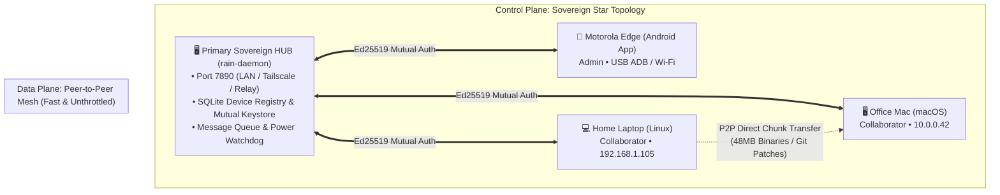

# 🌧️ RAIN — Remote Agent Infrastructure Network

> **A sovereign, decentralized, peer-to-peer personal cloud and autonomous AI agent orchestration network with a WhatsApp-grade mobile workbench.**

[](LICENSE)
[](https://www.rust-lang.org/)
[](https://tauri.app/)
[](https://www.typescriptlang.org/)

---

## 💡 Overview

**RAIN (Remote Agent Infrastructure Network)** transforms your computers, home labs, and office workstations into a **sovereign, private, decentralized cloud**. Instead of paying cloud vendors or routing sensitive code through third parties, your machines act as autonomous peer nodes in an end-to-end encrypted cluster.

RAIN provides:
1. **WhatsApp-Grade Mobile Experience:** Monitor hardware, browse remote filesystems, execute privileged `sudo` commands, and orchestrate agent teams directly from your phone.
2. **Autonomous Cross-Machine Delegation:** Agents communicate across systems (e.g. Claude CLI on an Office Mac coordinating with Codex CLI on a GPU laptop) to delegate builds, transfer artifacts, and share resources.
3. **Hardware-Aware Autonomous Battery Failover:** When a mobile laptop drops to 5% battery, agents automatically commit uncommitted changes to Git, push to remote, and migrate the session context to an AC-powered node.
4. **Sovereign Star-Mesh Topology & Instant Pairing:** Run one machine as your central Hub. Pair secondary devices with a **single QR scan**, a **6-digit PIN**, or **Email OTP**, with permanent zero-touch mutual authentication thereafter.

---

## 🏛️ Architecture



---

## ✨ Key Features

### 1. 👥 Dynamic Groups & Direct 1-on-1 Agent Chat
* Create custom multi-agent strike teams on the fly with custom directives.
* Stop or delete active groups anytime from mobile.
* Direct 1-on-1 sessions with individual agents across any linked machine.
* Send rich attachments: code diffs, logs, screenshots, and payloads.

### 2. ⚡ Autonomous Cross-Machine Collaboration & Job Cards
* Interactive **Distributed Cloud Job Cards** rendered in real time with live progress indicators.
* Machines publish hardware catalogs (CPU cores, RAM, GPU models, link speeds).
* When a task requires specialized compute (e.g. discrete GPU or high-thread CPU), agents autonomously hand off the task and stream build artifacts peer-to-peer.

### 3. 🔋 Hardware-Aware 5% Battery Git Evacuation
* Real-time battery & power supply monitoring across all cluster nodes.
* **Autonomous Power Evacuation:** When battery reaches critical threshold (<= 5% discharging), agents automatically:
  1. `git add -A` and `git commit -m "chore: auto-checkpoint (battery critical)"`.
  2. `git push origin <branch>`.
  3. Transfer the active task context to an AC-connected node.
  4. Resume execution on the target node so the laptop can safely suspend.

### 4. 🖥️ Remote Machine Dashboard, File Explorer & Terminal
* **Hardware Telemetry:** Live gauges for CPU, RAM, disk storage, and battery.
* **Remote File Explorer & Editor:** Browse directories with breadcrumbs, inspect files, and edit code with in-app "Save to Machine".
* **Remote App Launcher:** Launch desktop applications (VS Code, Blender, Godot, Firefox) remotely.
* **Sudo Approval Gates:** Privileged commands require human-in-the-loop authorization with password elevation from mobile.

### 5. 🔗 3-Way Instant Pairing & Zero-Touch Reconnection
* **Host Mode (QR Code & Deep Link):** Scan with mobile camera to pair in 1 second.
* **6-Digit Machine PIN:** Simple code verification like pairing Apple TV or WhatsApp Web.
* **Email OTP:** Secure onboarding for coworkers or friends without sharing terminal credentials.
* **Permanent Mutual Auth:** Cryptographic token saved locally; zero passwords on future reconnects.

---

## 📂 Project Structure

```
project-rain/
├── crates/
│   ├── rain-protocol/        # Core message schemas, job delegation, & auth models
│   ├── rain-core/            # Chat store, remote workbench manager, & state engine
│   └── rain-platform/        # Native OS abstractions & platform hooks
├── services/
│   └── rain-daemon/          # Sovereign host HTTP & WebSocket server (port 7890)
└── apps/
    └── rain-client/          # TypeScript SPA & Tauri 2.0 Android / Desktop client
```

---

## 🚀 Quickstart

### 1. Prerequisites
* **Rust:** 1.80+ (`rustup default stable`)
* **Node.js:** 18+ & `npm`
* **Android SDK & NDK:** (Optional, for building the Android APK)

### 2. Run the Sovereign Daemon (Host)
```bash
cargo run --bin rain-daemon
```
The daemon starts on `http://0.0.0.0:7890`.

### 3. Run the Client (Web Preview / Desktop)
```bash
cd apps/rain-client
npm install
npm run dev
```

### 4. Build Android APK
```bash
cd apps/rain-client
npm run tauri android build -- --debug
```
The universal debug APK is generated at:
`apps/rain-client/src-tauri/gen/android/app/build/outputs/apk/universal/debug/app-universal-debug.apk`

---

## 🔒 Security & Privacy

* **Zero Centralized Servers:** All agent messaging, terminal commands, and telemetry route strictly through your sovereign nodes.
* **End-to-End Encryption:** Transport secured via Noise Protocol (ChaCha20-Poly1305) and Ed25519 mutual authentication.
* **Human-in-the-Loop Sudo Gates:** Sensitive commands require explicit mobile approval before execution.

---

## 📄 License

This project is licensed under the [MIT License](LICENSE).
